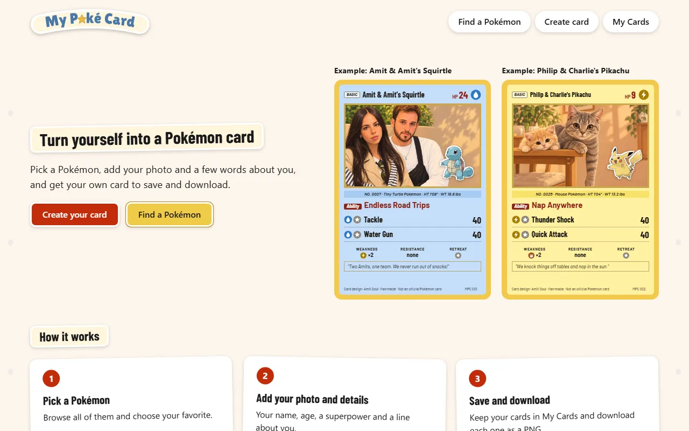
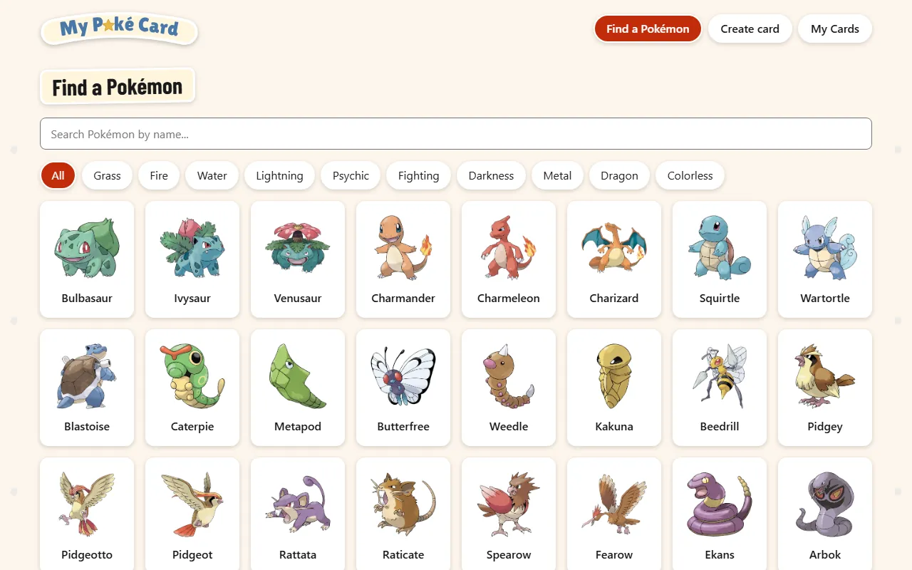
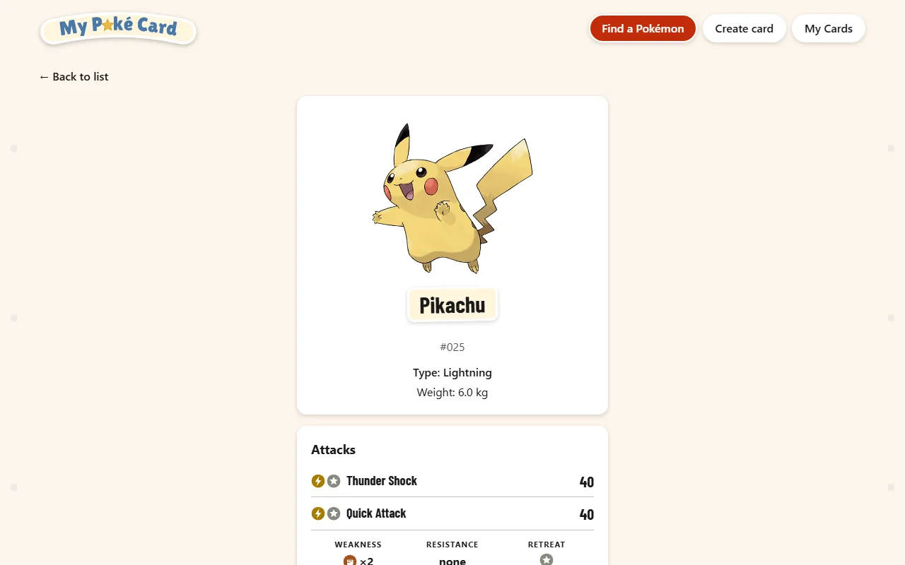
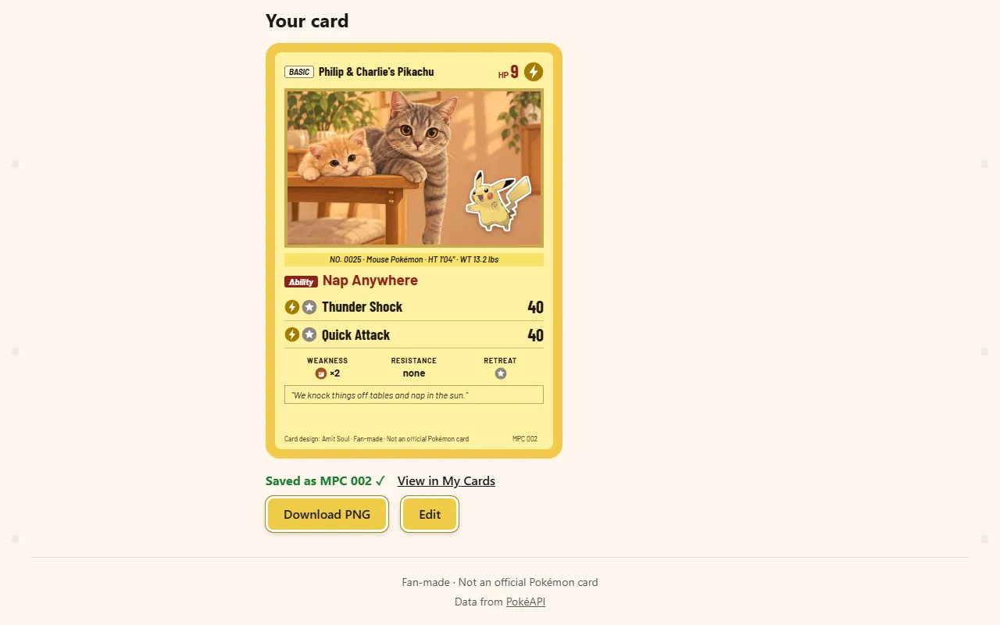
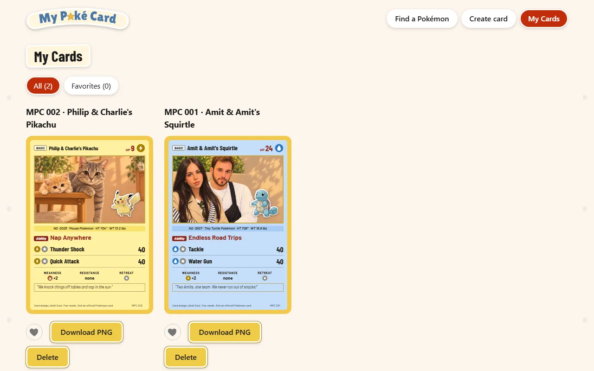
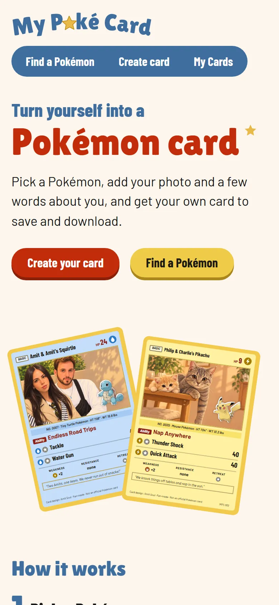
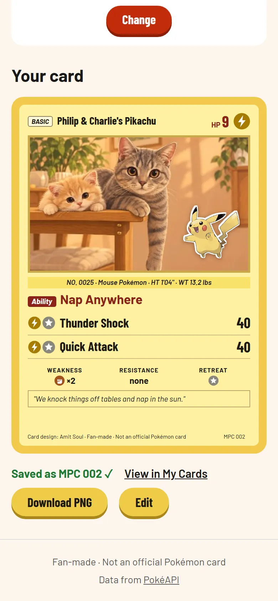
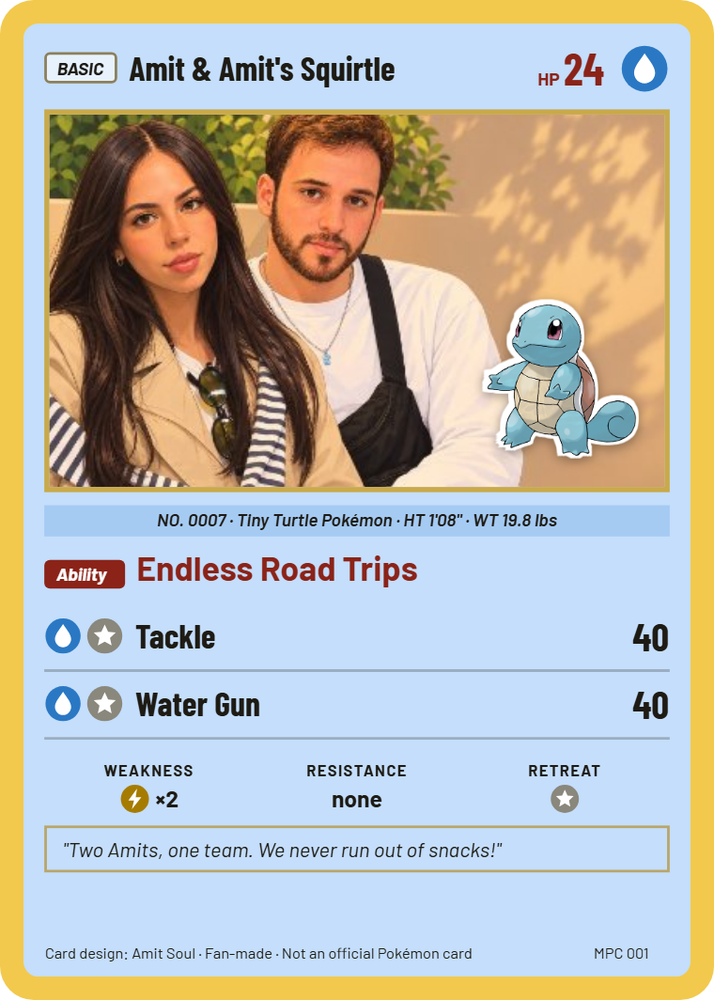

<p align="center">
  
</p>

**My Poké Card** lets you browse every Pokémon and turn yourself into a personal Pokémon-style trading card: pick your favorite Pokémon, add your photo and a few words about you, then save the card and download it as a PNG.

*Fan-made, non-commercial student project. Not an official Pokémon product.*

## Screenshots

| Landing page | Find a Pokémon |
|---|---|
|  |  |
| **Pokémon details** | **A created and saved card** |
|  |  |
| **My Cards** | |
|  | |

On a phone:

<p>
  
  
</p>

What **Download PNG** gives you (760 × 1064):



The two example cards use our own illustrations, published with permission.

## What it does

- **Find a Pokémon:** every species from PokéAPI, 50 at a time with *Load more*, with search by name and a filter by Type. Search and filter are kept in the URL.
- **Details:** official artwork, number, Type, weight, two attacks with their cost, and Weakness / Resistance / Retreat.
- **Create card:** choose your favorite Pokémon, then fill in your name, age (the card's HP), a photo, a superpower and a line about you. Every field is checked as you go. The card shows your photo with the Pokémon as a sticker you can drag (mouse, finger or arrow keys).
- **Save and My Cards:** cards are saved in the browser (localStorage) with a number that is never reused (MPC 001, MPC 002, …). Mark favorites with a heart, filter All / Favorites, delete with a confirm.
- **Download PNG:** every saved card can be downloaded as a 760 × 1064 PNG.

The card's rules (Types, Weakness and Resistance, attacks, units, design) are in [CARD_SPEC.md](CARD_SPEC.md).

## Pages and routes

| Route | Page |
|---|---|
| `/` | Landing page: what the app does, two example cards, how it works, about me |
| `/pokemon` | Find a Pokémon: the list with search (`?q=`) and Type filter (`?type=`) |
| `/pokemon/:id` | Details of one Pokémon (the id is read with `useParams`) |
| `/create` | Create card, before a Pokémon is chosen |
| `/create/:id` | Create card with that Pokémon |
| `/my-cards` | My Cards (`?show=favorites` for favorites only) |
| anything else | 404 page |

## Tech stack

- **React 19** + **Vite 8** + **TypeScript** (strict mode, no `any`, enforced by lint)
- **React Router 8**
- **Vitest 5**, **@vitest/ui**, **React Testing Library** and **jsdom** for the tests
- **html-to-image** for Download PNG
- **oxlint** for linting
- Our own CSS (no UI library); self-hosted fonts
- No server, no database, no login, no API keys

## Getting started

You need **Node.js 22.22 or newer** (React Router 8 and Vitest 5 need it).

```bash
npm install
npm run dev
```

Open the address it prints (usually `http://localhost:5173`).

To try it on a **phone**, run `npm run dev -- --host`, connect the phone to the same Wi-Fi, and open the *Network* address it prints.

| Command | What it does |
|---|---|
| `npm run dev` | Starts the app for development |
| `npm run build` | Type check (`tsc -b`) and production build into `dist/` |
| `npm run preview` | Serves the production build |
| `npm run lint` | Lints the code (oxlint) |
| `npm test` | Runs all tests once |
| `npm run test:ui` | Opens the Vitest UI in the browser |

## Tests

```bash
npm test          # all tests, once
npm run test:ui   # the Vitest UI
```

- **Logic** (`src/utils/*.test.ts`): Type mapping, Weakness / Resistance, attacks and their cost, units, form rules, search and filter, saved cards and their numbers, the sticker's limits, colors and contrast.
- **Components and pages** with React Testing Library: the card, the form, the sticker (drag and keyboard), the list, details, Create card, My Cards, the landing page and the nav.
- **A fake PokéAPI** (`src/test/fakeApi.ts`): tests never use the network.
- **No console errors:** any `console.error` or `console.warn` during a test makes it fail (`src/test/setup.ts`).
- **CSS:** `src/indexCss.test.ts` checks that every rule uses a class selector, so no style can reach the card by accident.

## Project structure

```
src/
  pages/        the 6 pages (one per route)
  components/   the 23 components
  hooks/        usePokemonDetails, usePokemonCardInfo
  utils/        the logic (no React), each with its tests
  data/         the landing page's two example cards
  types/        types for the PokéAPI data
  test/         test setup, fake API and fixtures
  assets/       fonts and the landing page illustrations
docs/           requirements checklist, logo, screenshots
```

**Components** (`src/components/`):

| Component | What it is |
|---|---|
| `NavBar` | The header: logo and nav links |
| `Logo` | The "My Poké Card" logo (SVG) |
| `SiteFooter` | The footer with the fan-made line |
| `PokemonList`, `PokemonListItem` | The Pokémon grid and one Pokémon in it |
| `SearchBar`, `CardTypeFilter` | Search by name, filter by Type |
| `PokemonDetails` | Artwork, number, Type and weight on the details page |
| `AttacksBlock`, `AttackList` | The attacks (with loading and error) and their rows |
| `WeaknessRow` | Weakness, Resistance and Retreat |
| `TypeSymbol` | Our own SVG symbol for each of the 10 Types |
| `FavoritePokemonField` | The chosen Pokémon on the Create page, with *Change* |
| `CardForm`, `FormField`, `PhotoField` | The Create form, one text field, the photo field |
| `InlineConfirm` | The "are you sure?" box (change Pokémon, delete a card) |
| `PokeCard` | The card itself |
| `CardSticker` | The Pokémon sticker on the photo (draggable before saving) |
| `SavedNotice` | "Saved as MPC 00X ✓" |
| `SavedCardItem` | One card in My Cards with its buttons |
| `FavoriteButton` | The heart |
| `DownloadPngButton` | Download PNG |

## Documentation

- [PRD.md](PRD.md): what the app is and why (one page)
- [CARD_SPEC.md](CARD_SPEC.md): the card's rules and design
- [tasks.md](tasks.md): the tasks in build order, each with "Done when"
- [docs/requirements-checklist.md](docs/requirements-checklist.md): every course requirement and where it is met
- [AGENTS.md](AGENTS.md): the working rules for the coding agent
- [PROMPTS.md](PROMPTS.md): the prompt log (see below)

**A note on Types:** the card uses the 10 Types of today's Pokémon card game. There is no Fairy Type any more, so Fairy Pokémon are shown as Psychic (details in [CARD_SPEC.md](CARD_SPEC.md)).

## Credits

- The logo's letters are drawn from **Lilita One** by Juan Montoreano, licensed under the SIL Open Font License 1.1 (`src/assets/fonts/OFL-LilitaOne.txt`). The card uses **Barlow** and **Barlow Condensed** (SIL OFL, `src/assets/fonts/OFL.txt`).
- Pokémon data from [PokéAPI](https://pokeapi.co); official artwork from the [PokéAPI sprites repository](https://github.com/PokeAPI/sprites).
- The two example illustrations are our own and are published with permission.
- Pokémon and Pokémon character names are trademarks of Nintendo, Game Freak and The Pokémon Company. This is a fan-made, non-commercial student project and not an official Pokémon product.

## How the prompt log works

Every prompt sent to the coding agent is added to [PROMPTS.md](PROMPTS.md) automatically:

- `.claude/settings.json` (Claude Code) and `.codex/hooks.json` (Codex) register a **`UserPromptSubmit` hook**: a command the agent runs each time a prompt is sent.
- The hook runs `scripts/log-prompt.mjs`, which appends the prompt to `PROMPTS.md` with the date, the time and the agent's name. Empty prompts and agent commands (like `/clear`) are skipped. If anything goes wrong, the script exits quietly, so it never breaks the session.
- To check it: send the agent any message, then run `tail -n 20 PROMPTS.md`.

Everything typed to the agent ends up in `PROMPTS.md`, which is public in this repository, so it should never contain passwords, keys or other people's personal details.
